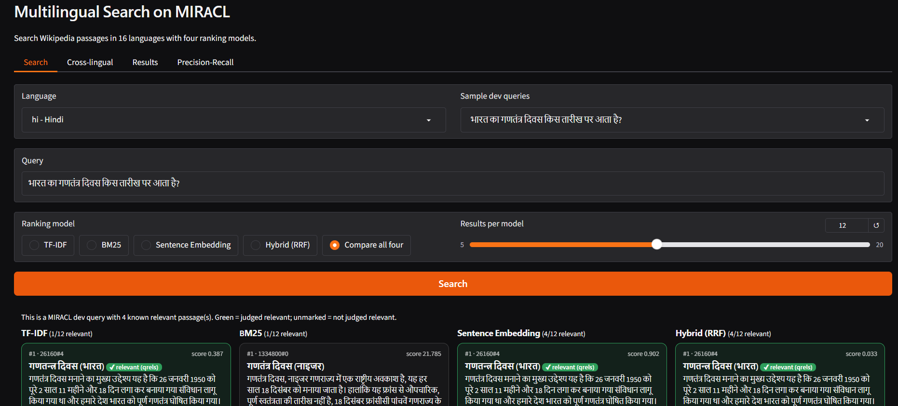
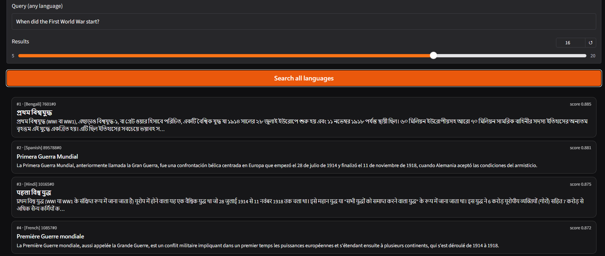
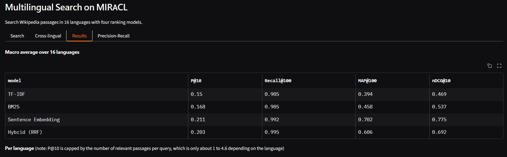
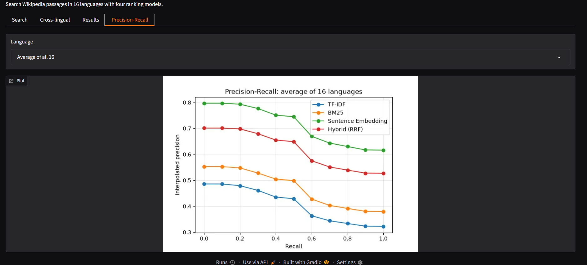

# Multilingual Search on MIRACL

Ad-hoc multilingual search over Wikipedia passages in 16 languages, comparing four ranking methods with standard IR metrics, plus a cross-lingual search across all languages. Includes an interactive Gradio app.

## What it does
- **Preprocessing:** Unicode cleaning, tokenization (character bigrams for Chinese, Japanese and Thai), data-driven stop-words, Snowball stemming (ar, en, es, fi, fr, ru) and a rule-based Hindi stemmer.
- **Ranking models:** TF-IDF, BM25, sentence embeddings (multilingual-e5-small), and a hybrid using Reciprocal Rank Fusion (RRF).
- **Cross-lingual search:** one shared embedding index over all 16 languages, so a query in one language retrieves passages in others.
- **Evaluation:** Precision@10, Recall@100, MAP@100, nDCG@10 and interpolated precision-recall curves.

## Screenshots

**Search: comparing all four models on a Hindi query (green = judged relevant)**



**Cross-lingual search: one question, answers from many languages**



**Results: macro average over 16 languages**



**Precision-recall curves (average of 16 languages)**



## Results (macro average over 16 languages)
| Model | P@10 | Recall@100 | MAP@100 | nDCG@10 |
|---|---|---|---|---|
| TF-IDF | 0.150 | 0.905 | 0.394 | 0.469 |
| BM25 | 0.168 | 0.905 | 0.458 | 0.537 |
| Sentence Embedding | 0.211 | 0.992 | 0.702 | 0.775 |
| Hybrid (RRF) | 0.203 | 0.995 | 0.606 | 0.692 |

Full per-language results are in `results/`. Dense retrieval is clearly best on ranking quality; hybrid RRF has the highest Recall@100 but does not beat dense on nDCG, because equal-weight fusion lets the weaker BM25 ranking dilute the dense one.

## Repository layout
- `app/` : Gradio app, retrieval engines and preprocessing
- `notebooks/` : the full pipeline notebook (corpus building, indexing, embedding, evaluation)
- `results/` : comparison tables, plots and screenshots

## Run locally
```bash
git clone https://github.com/aadcodes/miracl-multilingual-search.git
cd miracl-multilingual-search
python -m venv .venv
.venv\Scripts\activate        # Windows (macOS/Linux: source .venv/bin/activate)
pip install -r requirements.txt
python app/app.py             # opens at http://127.0.0.1:7860
```

## Data
The processed corpora, tokenized files and embeddings (about 1.4 GB) are too large for GitHub. They are stored in a private Hugging Face dataset that `app/engines.py` downloads on first start. To run the app yourself, rebuild the data with the notebook in `notebooks/`, upload it to your own Hugging Face dataset repo, and set the `DATA_REPO` environment variable to its name (for example `export DATA_REPO=your-username/your-dataset`).

Each language corpus contains every judged passage plus random distractors, capped at 50,000 passages.

## Limitations
- Capped corpora make absolute scores higher than full-corpus MIRACL results, so only compare models against each other.
- Stemming and tokenization are uneven across languages.
- Cross-lingual search is shown qualitatively, since MIRACL relevance labels are monolingual.

## Dataset
MIRACL: Multilingual Information Retrieval Across a Continuum of Languages.
